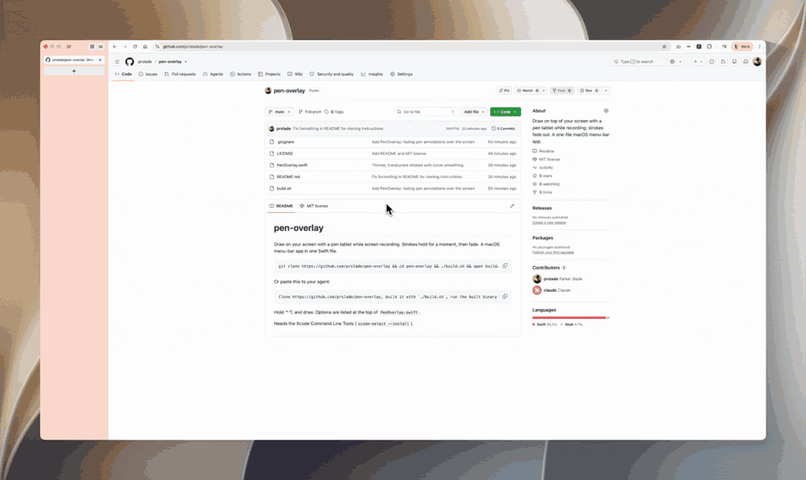

# pen-overlay

Draw on your screen with a pen tablet while screen recording. Strokes hold for a moment, then fade. A macOS menu-bar app in one Swift file.



```
git clone https://github.com/prslade/pen-overlay && cd pen-overlay && ./build.sh && open build/PenOverlay.app
```

Or paste this to your agent:

```
Clone https://github.com/prslade/pen-overlay, build it with `./build.sh`, run the built binary with `--selftest`, then launch it.
```

To install it as an app, run `./build.sh install`. That copies it to `~/Applications`, so you can open it from Spotlight or Launchpad. Then choose **Open at login** in the menu-bar menu to start it whenever you log in. It also appears in System Settings > General > Login Items, where you can switch it off.

Hold ⌃⌥ and draw. Options are listed at the top of `PenOverlay.swift`.

To keep drawings up instead of fading them, turn on **Keep drawings until trashed** in the menu-bar menu. While there is ink on screen, the macOS Trash appears in the bottom-right corner (drag it wherever you like); double-click it and everything is pulled in.

Needs the Xcode Command Line Tools (`xcode-select --install`).

To update, paste this to your agent:

```
Find my pen-overlay clone, run `git pull`, quit the running PenOverlay, rebuild with `./build.sh install`, and relaunch it.
```

If you installed it, use `./build.sh install` to update so the copy in `~/Applications` is the one that changes. The login item keeps working.
